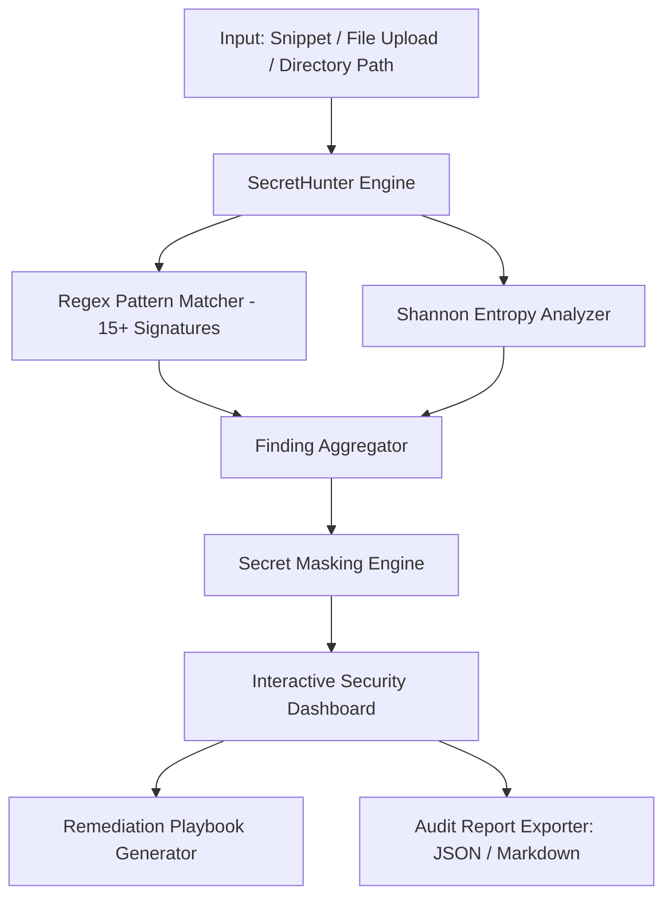

# 🔑 SecretHunter — Automated Secret & Credential Leak Detector

[](https://www.python.org/)
[](https://streamlit.io/)
[-red.svg)](https://owasp.org/)
[](LICENSE)

**SecretHunter** is a security auditing and credential detection engine built to identify accidental leaks of API keys, private cryptographic keys, database connection strings, OAuth tokens, and secrets across source code repositories, configuration files, `.env` files, and raw developer snippets.

---

## 🌟 Key Features

- **🔍 Multi-Vector Scanning**:
  - Direct snippet/clipboard code inspection.
  - Multi-file batch upload (`.env`, `.py`, `.js`, `.json`, `.yml`, `.sh`, `.tf`).
  - Full local repository/directory traversal with automatic ignore filters (`.git`, `node_modules`, `venv`).
- **🛡️ 15+ Enterprise Credential Signatures**:
  - **Cloud Providers**: AWS Access Key ID, AWS Secret Keys, Google Cloud / Firebase API Keys, Heroku.
  - **Version Control**: GitHub Classic Tokens (`ghp_`), GitHub Fine-Grained Tokens (`github_pat_`).
  - **AI / LLM Services**: OpenAI API Keys (`sk-` and `sk-proj-`), Anthropic tokens.
  - **Payment Gateways**: Stripe Live Secret & Restricted Keys (`sk_live_`, `rk_live_`).
  - **Databases**: Full connection strings with embedded passwords (PostgreSQL, MySQL, MongoDB, Redis).
  - **Cryptographic Keys**: RSA, OpenSSH, DSA, and EC private keys.
  - **Chat & Webhooks**: Slack Bot Tokens (`xoxb`), Slack Webhook URLs, Discord Bot Tokens.
- **📊 Shannon Entropy Verification**: Measures alphanumeric randomness to spot custom obfuscated tokens and non-standard API secrets.
- **👁️ Safe Redaction**: Automatically masks discovered secrets in preview grids and generated reports to prevent secondary visual leaks.
- **🛠️ Automated Remediation Guidance**: Generates tailored revocation checklists, git history purge commands (`git-filter-repo`), and `.gitignore` configuration steps.
- **📑 Multi-Format Report Export**: Download full audit results in **JSON** or **Markdown**.

---

## 🏗️ System Architecture



---

## 🚀 Quick Start Guide

### Prerequisites
- Python 3.9 or higher installed.

### 1. Clone the Repository
```bash
git clone https://github.com/YOUR_USERNAME/SecretHunter-SecretLeakDetector.git
cd SecretHunter-SecretLeakDetector
```

### 2. Create and Activate Virtual Environment
```bash
# Windows
python -m venv venv
venv\Scripts\activate

# macOS / Linux
python3 -m venv venv
source venv/bin/activate
```

### 3. Install Dependencies
```bash
pip install -r requirements.txt
```

### 4. Launch the Dashboard
```bash
streamlit run app.py
```
Open your browser at `http://localhost:8501`.

---

## 📁 Project Structure

```
SecretHunter-SecretLeakDetector/
│
├── app.py                 # Core Streamlit secret detection scanner
├── requirements.txt       # Project dependencies
├── README.md              # Project documentation & GitHub showcase
└── PROJECT_REPORT.md      # Comprehensive academic & technical report
```

---

## ⚠️ Security Best Practices for Developers
1. Never commit `.env` or credential files into source control.
2. Always add sensitive configuration files to `.gitignore`.
3. Use centralized secret management solutions (AWS Secrets Manager, HashiCorp Vault, Azure Key Vault).
4. Run SecretHunter as a pre-commit check or CI/CD pipeline step.

---

## 🛡️ License
Distributed under the MIT License. See `LICENSE` for details.
